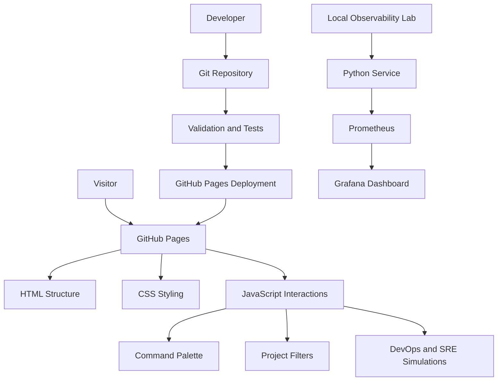
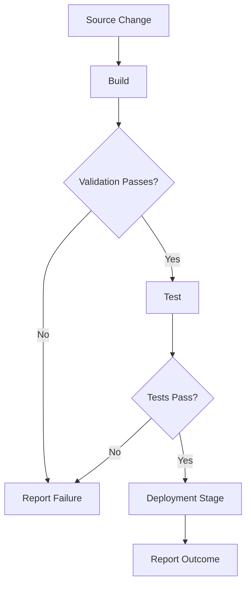
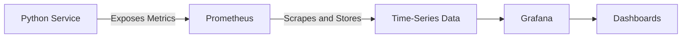
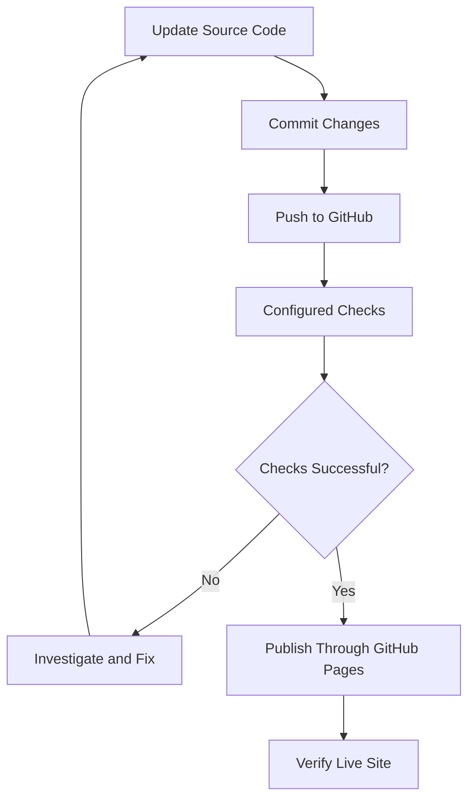

# 🚀 DevOps & SRE Portfolio

<p align="center">
  
  
  
  
</p>

<p align="center">
  <b>A hands-on portfolio showcasing DevOps concepts, Site Reliability Engineering, automation, CI/CD simulations, and observability.</b>
</p>

<p align="center">
  🌐 <b>Live Portfolio:</b>
  <a href="https://md-sh0han.github.io/PORTFOLIO/">View Portfolio</a>
  &nbsp;•&nbsp;
  💻 <b>Repository:</b>
  <a href="https://github.com/MD-SH0HAN/PORTFOLIO">GitHub Source</a>
</p>

---

## 📌 Table of Contents

- [🎯 Project Overview](#-project-overview)
- [✨ Key Features](#-key-features)
- [🛠️ Technology Stack](#️-technology-stack)
- [🏗️ Architecture](#️-architecture)
- [🧠 Core Algorithms and Logic](#-core-algorithms-and-logic)
- [📂 Project Structure](#-project-structure)
- [⚙️ Getting Started](#️-getting-started)
- [📊 Observability Lab](#-observability-lab)
- [🧪 Testing and Quality Assurance](#-testing-and-quality-assurance)
- [🚀 Deployment](#-deployment)
- [🔐 Security and Best Practices](#-security-and-best-practices)
- [⚠️ Scope and Limitations](#️-scope-and-limitations)
- [🗺️ Future Improvements](#️-future-improvements)
- [🤝 Contributing](#-contributing)
- [📄 License](#-license)
- [📬 Contact](#-contact)

---

## 🎯 Project Overview

This repository contains a personal portfolio designed to demonstrate practical knowledge of **DevOps, Site Reliability Engineering (SRE), CI/CD, monitoring, and software delivery workflows**.

Rather than being only a static portfolio, the project combines a responsive frontend with interactive engineering demonstrations and a local observability lab.

### 🎯 Project Goals

- 🧑‍💻 Present technical projects, skills, and engineering experience.
- ⚙️ Demonstrate automation and software delivery concepts.
- 🔄 Simulate CI/CD workflows and deployment-related scenarios.
- ☸️ Illustrate Kubernetes and service-readiness concepts interactively.
- 📈 Explore application metrics and observability using Prometheus and Grafana.
- 🧪 Improve reliability through browser-based smoke testing.
- 📚 Document architecture, setup procedures, and engineering trade-offs.

### 🌐 Live Demo

**[Open the live portfolio →](https://md-sh0han.github.io/PORTFOLIO/)**

The live site is hosted with GitHub Pages. Local services used by the observability lab are separate from the publicly hosted static portfolio.

---

## ✨ Key Features

### 🎨 1. Responsive Portfolio Interface

- Clean, modern portfolio layout.
- Organized project and technical-skill sections.
- Responsive styling for different screen sizes.
- Interactive elements implemented with JavaScript.
- Navigation and keyboard-friendly interactions where supported.

### 🧭 2. Command Palette

A keyboard-accessible command interface helps users navigate the portfolio and trigger supported actions.

**Typical interaction flow:**

1. Open the command palette.
2. Search for an available command.
3. Select a matching action.
4. Execute the action.
5. Close the palette and return to the page.

The exact commands depend on the implementation in the repository.

### ☁️ 3. DevOps and CI/CD Demonstrations

Interactive experiences illustrate concepts such as:

- Build and delivery stages.
- Workflow progression.
- Deployment status and outcomes.
- Cloud-oriented project filtering.
- Delivery-related user interactions.

These frontend demonstrations are designed for learning and presentation. They do not automatically constitute a connection to a real cloud account or production deployment pipeline.

### ☸️ 4. Kubernetes and Readiness Concepts

The portfolio includes interactive demonstrations of Kubernetes-style concepts, including readiness and workload status.

These help communicate how engineers think about application health, rollout readiness, and service availability. They are simulations unless explicitly connected to a real Kubernetes cluster.

### 🚨 5. SRE Control Room

The SRE-focused experience demonstrates reliability concepts such as:

- Service health.
- Incident and alert scenarios.
- Availability and reliability thinking.
- Observability concepts.
- Operational status visualization.

It provides a visual learning environment for SRE concepts rather than a production incident-management system.

### 📊 6. Local Observability Lab

A separate project demonstrates a local monitoring stack built around:

- 🐍 Python service
- 📈 Prometheus metrics collection
- 📊 Grafana dashboards
- 🐳 Docker Compose orchestration

This lab provides a foundation for experimenting with metrics, dashboards, and service observability on a local machine.

### 🧪 7. Browser Smoke Testing

Browser automation helps validate key user-facing behavior, including navigation, filters, command-palette interactions, and other important UI flows.

Smoke tests are useful for catching common regressions before publishing changes. Their results depend on the test environment, browser setup, and current application behavior.

---

## 🛠️ Technology Stack

### 🌐 Frontend and UI

<p>
  
  
  
</p>

Used to build the portfolio's structure, visual styling, responsive layouts, and browser interactions.

### ☁️ DevOps and Deployment

<p>
  
  
  
  
</p>

Used for the local containerized lab, version-controlled delivery workflows, static-site hosting, and development environments where configured.

### 📊 Observability and Monitoring

<p>
  
  
</p>

Prometheus collects metrics in the local lab, while Grafana provides dashboards for visualizing supported monitoring data.

### 🐍 Backend and Testing

<p>
  
  
</p>

Python supports the observability example service and relevant test tooling. Playwright is used where configured for browser automation.

### 🔧 Development Tools

<p>
  
  
  
</p>

> **Note:** These are technology badges, not live status indicators. Keep only the tools that are actually used by the corresponding project code or workflow.

### 🧩 Stack at a Glance

| Area | Technology | Role |
|---|---|---|
| 🎨 Frontend | HTML5, CSS3, JavaScript | Portfolio UI and interactions |
| 🌍 Hosting | GitHub Pages | Public static-site hosting |
| 🔄 CI/CD | GitHub Actions, if configured | Workflow automation and checks |
| 📦 Containers | Docker Compose | Local observability environment |
| 🐍 Example service | Python | Metrics-producing application |
| 📈 Metrics | Prometheus | Metrics scraping and storage |
| 📊 Dashboards | Grafana | Metrics visualization |
| 🧪 Browser tests | Playwright, Python | UI smoke testing where configured |
| 🗂️ Version control | Git, GitHub | Source management and collaboration |

---

## 🏗️ Architecture

The repository has two main parts: the public portfolio and the local observability lab.

### High-Level Architecture



### 🧱 Architecture Components

| Component | Responsibility |
|---|---|
| Static frontend | Renders the portfolio pages and project content |
| JavaScript layer | Handles interactive behavior and UI state |
| Git repository | Stores source code and configuration |
| Validation tooling | Checks selected functionality and expected behavior |
| GitHub Pages | Publishes the static portfolio |
| Local Python service | Exposes example service metrics |
| Prometheus | Scrapes and stores metrics |
| Grafana | Visualizes metrics using dashboards |

The public static site and local observability services are separate execution environments. The diagram describes the intended conceptual flow; exact CI/CD steps depend on the repository's current workflow configuration.

---

## 🧠 Core Algorithms and Logic

The project combines straightforward browser-side logic with operational concepts demonstrated through the observability lab.

### 1. 🔎 Command Palette Search

**Purpose:** Help users find and execute available portfolio commands.

**Conceptual algorithm:**

```text
INPUT: Search query, available commands

1. Normalize the search query.
2. Retrieve the available commands.
3. Compare the query with command labels or keywords.
4. Display matching commands.
5. Allow the user to select a command.
6. Execute the selected action.
7. Close the palette when appropriate.

OUTPUT: Matching commands and the selected action
```

**Complexity:** For `n` commands and a basic full scan, matching is generally \(O(n)\) per query, excluding the cost of string comparisons.

### 2. 🗂️ Project Filtering

**Purpose:** Display projects matching a selected category, such as cloud or delivery.

**Conceptual algorithm:**

```text
INPUT: Project collection, selected filter

1. Read the active filter.
2. Iterate over the project collection.
3. Check each project's category or supported attributes.
4. Include matching projects.
5. Update the displayed project list.
6. Update the filter's selected state.

OUTPUT: Projects matching the active filter
```

**Complexity:** A basic filter over `n` projects is \(O(n)\) per filter operation.

### 3. 🚦 Simulated Delivery Workflow

**Purpose:** Explain the stages commonly found in a CI/CD pipeline.



This is a conceptual delivery flow. The portfolio's visual simulation does not deploy an application to a real environment unless separately integrated with actual infrastructure and credentials.

### 4. ☸️ Service Readiness Concept

**Purpose:** Illustrate how an application may be evaluated before receiving traffic.

```text
INPUT: Simulated service status

1. Read the service's simulated health state.
2. Evaluate the readiness condition.
3. If ready, represent the service as eligible for traffic.
4. If not ready, represent the service as unavailable.
5. Update the displayed status.

OUTPUT: Simulated readiness state
```

A real Kubernetes readiness probe is evaluated by the Kubernetes platform using configured probe rules. The portfolio's visual representation should not be confused with an actual cluster health check.

### 5. 📈 Metrics Collection and Visualization

**Purpose:** Demonstrate the relationship between a service, a metrics collector, and a dashboard.



The local lab can be used to explore metrics collection and visualization. Specific metrics, scrape intervals, dashboards, and alerting behavior depend on the lab configuration.

### 6. 🧪 Browser Smoke Testing

**Purpose:** Validate important user interactions in a real browser.

```text
INPUT: Test configuration and application URL

1. Start the browser.
2. Navigate to the application.
3. Wait for the page to reach the required state.
4. Locate the relevant UI element.
5. Perform the interaction.
6. Verify the expected result.
7. Report success or failure.
8. Capture diagnostic information when configured.
9. Close browser resources.

OUTPUT: Test results
```

Robust browser tests should wait for meaningful UI state changes instead of relying on arbitrary delays wherever possible. They should also account for dialogs, overlays, and elements that can intercept pointer events.

---

## 📂 Project Structure

The following is a **logical overview** of the project. Confirm exact filenames and paths against the current repository before using this as a literal directory inventory.

```text
PORTFOLIO/
├── index.html
├── style.css
├── script.js
├── .nojekyll
├── README.md
├── .github/
│   └── workflows/
│       └── <workflow-files>
├── scripts/
│   └── <browser-smoke-test-files>
└── projects/
    └── observability-lab/
        ├── docker-compose.yml
        ├── .env.example
        ├── <python-service-files>
        ├── <prometheus-configuration>
        └── <grafana-configuration>
```

### 📁 Important Areas

- `index.html` — primary page structure.
- `style.css` — layout, responsive styling, and visual design.
- `script.js` — interactive UI logic.
- `.nojekyll` — prevents GitHub Pages from applying Jekyll processing to the published site.
- `.github/workflows/` — automation workflows, if present.
- `scripts/` — testing or development scripts, if present.
- `projects/observability-lab/` — local monitoring lab, if present.
- `README.md` — project documentation.

> The directory tree is illustrative, not a guarantee that every placeholder file or folder exists under that exact name.

---

## ⚙️ Getting Started

### 📋 Prerequisites

For the static portfolio:

- Git
- A modern web browser
- A local editor, such as Visual Studio Code

For the observability lab, if you want to run it:

- Docker Engine or Docker Desktop
- Docker Compose support
- Python, if running the service directly or using Python-based tools

### 1. 📥 Clone the Repository

```bash
git clone https://github.com/MD-SH0HAN/PORTFOLIO.git
cd PORTFOLIO
```

### 2. 🌐 Run the Portfolio Locally

If the project is a plain static site, you can open `index.html` in your browser.

Alternatively, start a local HTTP server from the repository root:

```bash
python -m http.server 8000
```

Open:

```text
http://localhost:8000
```

Stop the server with `Ctrl+C`.

### 3. 🔍 Validate the Interface

Manually check the key user flows:

- Page loads without missing assets.
- Navigation works as expected.
- Command palette opens and closes.
- Search returns relevant commands.
- Project filters update the displayed projects.
- Keyboard interactions work where supported.
- Responsive layout works at desktop and mobile widths.
- Browser console contains no unexpected errors.

### 4. 📊 Start the Observability Lab

Navigate to the lab directory:

```bash
cd projects/observability-lab
```

If the project provides a `.env.example`, create a local environment file:

```bash
cp .env.example .env
```

Review `.env.example` and the lab documentation. Set appropriate local values in `.env` before starting services.

Start the stack:

```bash
docker compose up -d --build
```

Inspect running services:

```bash
docker compose ps
```

Review logs:

```bash
docker compose logs --tail=100
```

Stop the stack when finished:

```bash
docker compose down
```

The actual service names, ports, environment variables, and endpoints depend on the Compose configuration in the repository. Check the lab's configuration before assuming a particular URL or port.

---

## 📊 Observability Lab

The observability lab provides a practical introduction to collecting and visualizing service metrics.

### 🔭 How It Works

1. The Python service exposes supported metrics.
2. Prometheus scrapes the configured metrics endpoint.
3. Prometheus stores the collected time-series data.
4. Grafana connects to Prometheus as a data source.
5. Dashboards visualize the metrics for inspection.

### 🧩 Responsibilities

| Component | Function |
|---|---|
| Python service | Generates application behavior and exposes metrics |
| Prometheus | Collects and stores time-series metrics |
| Grafana | Displays metrics in dashboards |
| Docker Compose | Coordinates the local containers and services |

### 📈 What You Can Learn

- How metrics endpoints work.
- How Prometheus scraping is configured.
- How to connect a data source to Grafana.
- How dashboards help identify trends.
- How monitoring contributes to reliability.
- Why a healthy application process and a healthy user experience are not always the same thing.

### 🔐 Local Configuration

Use `.env.example` as a template if it is included in the lab. Keep `.env` and other files containing secrets out of version control.

Do not expose unauthenticated monitoring dashboards or service metrics publicly without appropriate access controls.

---

## 🧪 Testing and Quality Assurance

Testing helps ensure that the portfolio behaves as expected after changes.

### 🔍 Recommended Validation Layers

| Test layer | What it checks |
|---|---|
| Static checks | HTML, CSS, JavaScript, and configuration issues |
| Browser smoke tests | Key interactions in a real browser |
| Integration checks | Communication between local lab services |
| Manual review | Responsive layout, accessibility, and user experience |
| Deployment verification | Whether the published site serves the expected version |

### 🧭 Browser Smoke-Test Checklist

- [ ] Portfolio page loads successfully.
- [ ] Key sections and project links are available.
- [ ] Command palette opens and closes.
- [ ] Command search returns the expected matches.
- [ ] Project filters update the displayed results.
- [ ] Dialogs and overlays do not block intended interactions.
- [ ] Important controls are usable with a keyboard.
- [ ] Browser console is checked for errors.
- [ ] The deployed site is verified after publishing.

### ⏱️ Reliable Browser Automation

Browser tests should preferably:

- Wait for explicit application states.
- Use stable selectors.
- Check accessible names and selected states.
- Avoid fixed sleeps when a state-based wait is available.
- Close dialogs or overlays before interacting with obscured controls.
- Capture useful logs or screenshots when a test fails.

### 🚦 Interpreting Test Results

A deployment can succeed even if an independent smoke test fails. For example, a timeout or an overlay intercepting a click may indicate a test synchronization or UI-interaction issue rather than a hosting failure.

Investigate failures individually, fix the underlying issue, and rerun the relevant tests. Do not report a workflow as passing unless its actual result confirms success.

---

## 🚀 Deployment

The portfolio is intended to be published as a static site using GitHub Pages.

### 📦 Deployment Flow



The exact automated checks and publishing mechanism depend on the repository's current GitHub configuration.

### 🛠️ Deployment Steps

1. Make changes locally.
2. Test the portfolio in a browser.
3. Review the Git diff.
4. Commit and push the changes.
5. Inspect any configured GitHub Actions workflows.
6. Verify GitHub Pages deployment status.
7. Open the live site and check the published version.

Example:

```bash
git add .
git commit -m "Improve portfolio documentation and UI"
git push origin main
```

If your default branch is not `main`, replace it with the correct branch name.

### 🌍 Live Deployment

- **Portfolio:** https://md-sh0han.github.io/PORTFOLIO/
- **Repository:** https://github.com/MD-SH0HAN/PORTFOLIO

A successful local test does not guarantee a successful deployment, and a successful deployment does not guarantee every interaction works. Validate both separately.

---

## 🔐 Security and Best Practices

Security matters even in portfolio and demonstration projects.

### 🔑 Secrets Management

- Never commit passwords, access tokens, private keys, or production credentials.
- Keep local `.env` files out of Git.
- Provide placeholder values through `.env.example`.
- Use long, unique passwords for local services that require authentication.
- Rotate any credential that has accidentally been exposed.

### 🐳 Container Security

- Use trusted container images.
- Avoid exposing unnecessary ports.
- Avoid running containers with excessive privileges.
- Keep container images and dependencies updated.
- Review Docker Compose settings before exposing services outside the local machine.

### 🌐 Frontend Security

- Avoid embedding secrets in frontend JavaScript.
- Validate and safely handle user-controlled content.
- Use HTTPS for the deployed portfolio.
- Keep external dependencies limited to those that are needed.
- Check accessibility and browser compatibility as part of quality assurance.

### 🔒 Monitoring Security

Prometheus metrics and Grafana dashboards may expose operational information. Restrict access to monitoring services and avoid publishing sensitive internal metrics or labels.

---

## ⚠️ Scope and Limitations

This repository combines a public static portfolio, interactive demonstrations, and a local reference lab. These parts have different capabilities.

| Feature | Scope |
|---|---|
| Portfolio website | Public static website |
| Command palette and filters | Browser-side interactions |
| CI/CD demonstration | Simulated workflow unless integrated with a real pipeline |
| Kubernetes demonstration | Conceptual UI unless connected to a real cluster |
| SRE Control Room | Demonstration of reliability concepts, not a production control plane |
| Prometheus and Grafana | Local observability lab |
| Browser smoke tests | Validation of the scenarios actually covered by the tests |

The presence of a technology badge or visual simulation does not prove that the technology is operating as a live production service.

---

## 🗺️ Future Improvements

Potential enhancements include:

- [ ] Add automated accessibility checks.
- [ ] Improve command-palette keyboard navigation and focus management.
- [ ] Add broader browser coverage for critical interactions.
- [ ] Add clear loading, empty, and error states to interactive components.
- [ ] Expand observability dashboards with additional useful metrics.
- [ ] Add alerting examples to the local monitoring lab.
- [ ] Improve automated deployment verification.
- [ ] Document the exact local service URLs and ports.
- [ ] Add architecture diagrams for individual projects.
- [ ] Add a changelog for notable releases.
- [ ] Add verified CI status badges after confirming the workflow path and status endpoint.
- [ ] Improve performance, metadata, and accessibility for the public site.

---

## 🤝 Contributing

Suggestions, bug reports, and improvements are welcome.

### 🧑‍💻 Contribution Workflow

1. Fork the repository.
2. Create a feature branch.
3. Make a focused change.
4. Run relevant tests and local checks.
5. Commit with a descriptive message.
6. Open a pull request explaining the change.

Example:

```bash
git checkout -b feature/improve-portfolio
git add .
git commit -m "Improve portfolio interactions"
git push origin feature/improve-portfolio
```

Keep contributions focused, avoid committing secrets, and update documentation when behavior or setup steps change.

---

## 📄 License

No license is specified in this README. Before reusing or distributing this project, check whether the repository contains a `LICENSE` file. If you want others to reuse the code, consider adding an appropriate open-source license.

---

## 📬 Contact

**Project Owner:** MD-SH0HAN

- 🌐 Portfolio: https://md-sh0han.github.io/PORTFOLIO/
- 💻 GitHub: https://github.com/MD-SH0HAN

For questions, feedback, or collaboration, open an issue or use the contact information published on the portfolio.

---

<p align="center">
  <b>⚙️ Automate thoughtfully. 📊 Observe continuously. 🚀 Deliver reliably.</b>
</p>

<p align="center">
  <i>Built to showcase practical DevOps and SRE concepts through interactive demonstrations and hands-on learning.</i>
</p>
