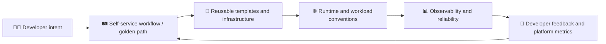

<h1 align="center">PLATFORM ENGINEERING PORTFOLIO</h1>

<p align="center">
  <strong>⚙️ Platform Engineering&nbsp; · &nbsp;☁️ Infrastructure&nbsp; · &nbsp;📈 Reliability&nbsp; · &nbsp;🧑‍💻 Developer Experience</strong>
  <br />
  <br />
  A responsive, monochrome portfolio exploring how platform teams turn infrastructure capabilities into a useful internal product for application developers.
</p>

<p align="center">
  <a href="https://md-sh0han.github.io/PORTFOLIO/">
    
  </a>
  <a href="https://github.com/MD-SH0HAN/PORTFOLIO">
    
  </a>
  </p>
  
  <p align="center">
  <a href="https://github.com/MD-SH0HAN/PORTFOLIO/actions/workflows/deploy-pages.yml.yml">
    
  </a>
</p>

<p align="center">
  
  
  
  
  
  
  
  
</p>

> 🔎 **Scope & integrity** — This portfolio clearly separates runnable source code from conceptual models, browser-only simulations, and planned build briefs. The **observability reference lab** is the included local implementation. The IDP, service catalog, platform APIs, policy engine, and planned golden paths are **not** presented as completed production systems.

---

## 🧭 On this page

- [Overview](#overview)
- [Platform-engineering model](#platform-engineering-model)
- [What's included](#whats-included)
- [Project status](#project-status)
- [Repository layout](#repository-layout)
- [Run the portfolio locally](#run-the-portfolio-locally)
- [Validate the project](#validate-the-project)
- [Run the observability reference lab](#run-the-observability-reference-lab)
- [Publish with GitHub Pages](#publish-with-github-pages)
- [Security and limitations](#security-and-limitations)
- [References](#references)
- [Content maintenance](#content-maintenance)

<a id="overview"></a>
## 🧩 Overview

This portfolio explores how a platform team can build and continuously improve an internal product for application developers.

| Capability | What it covers |
| --- | --- |
| **🧱 Internal developer platform (IDP)** | A coherent set of self-service workflows, templates, service discovery, documentation, platform APIs, and runtime capabilities. |
| **🛤️ Golden paths** | Supported defaults for creating, validating, packaging, deploying, and operating services—with documented extension points instead of rigid lock-in. |
| **🏗️ Infrastructure foundations** | Infrastructure as code, reusable modules, identity boundaries, cost awareness, and policy checks. |
| **🧑‍💻 Developer experience** | Service templates and catalogs, onboarding, documentation, useful feedback, and less repetitive platform toil. |
| **📈 Runtime and reliability** | Kubernetes workload conventions, health contracts, safe rollouts, observability, SLOs, runbooks, and recovery practices. |
| **🔁 Platform as a product** | Using developer feedback, adoption, time-to-first-deploy, friction, reliability, and support signals to guide platform improvements. |

The website also includes a technology map and a learning sequence organized around platform-engineering capabilities—not unrelated career tracks.

<a id="platform-engineering-model"></a>
## 🏗️ Platform-engineering model

The diagram below describes the **intended conceptual workflow**. It does not imply that every component is already implemented as a working platform service.



> **The feedback loop matters:** golden paths provide supported defaults, guardrails help keep workflows safer, and developer feedback informs the next improvement cycle.

<a id="whats-included"></a>
## ✨ What's included

- **🖥️ Responsive portfolio website** — accessible dark/light themes, reduced-motion handling, keyboard-friendly navigation, and a searchable command palette.
- **🗺️ Platform capability map** — a conceptual workflow connecting developer intent, golden paths, reusable artifacts, runtime capabilities, and feedback.
- **📦 Platform-as-product content** — IDPs, golden paths, guardrails, developer experience, and feedback loops.
- **🧪 Four project cards** — one local observability reference implementation and three clearly labelled planned platform build briefs.
- **🧭 Browser-only demonstrations** — golden-path workflow, Kubernetes readiness, example traces, release differences, change replay, recovery decisions, and SLO/error-budget modeling. These demonstrations do not contact live infrastructure.
- **🚦 Quality and publishing workflow** — GitHub Actions checks configured for static/API validation, Chromium browser regression tests, Docker Compose integration tests, and a Pages deployment gated on successful checks.

<a id="project-status"></a>
## 🚦 Project status

The status markers below distinguish what can be run from what is illustrative or planned.

| Component | Status | What that means |
| --- | --- | --- |
| **Observability reference lab** | ✅ `Runnable locally` | Includes a local API, tests, Prometheus configuration and alert rules, Grafana dashboard provisioning, and Docker Compose configuration. Run it locally to verify the integration. |
| **Golden-path delivery workflow** | 🧱 `Planned build brief` | A proposed build—not a completed deployment workflow. |
| **Self-service infrastructure foundation** | 🧱 `Planned build brief` | A proposed infrastructure foundation—not a deployed self-service platform. |
| **Kubernetes platform operations lab** | 🧱 `Planned build brief` | A proposed lab—not a completed Kubernetes platform implementation. |
| **Platform map and interactive demos** | 🖱️ `Browser simulation` | Illustrative interactions only; they do not control a cluster or contact live services. |
| **IDP, service catalog, platform APIs, policy engine, and GitOps controller** | 💡 `Conceptual` | These are part of the model and are not claimed as implemented production components. |

> 📊 **Sample data notice:** dashboard preview values are illustrative sample values—not live traffic, production telemetry, or measured performance results.

<a id="repository-layout"></a>
## 📁 Repository layout

```text
.
├── index.html
├── styles.css
├── script.js
├── assets/
├── Profile Photo.webp
├── Orbit Photo.webp
├── projects/
│   └── observability-lab/          # Local API + Prometheus + Grafana reference lab
├── scripts/                        # Static, release, browser, and integration checks
├── tests/
│   └── browser/                    # Playwright/Chromium regression tests
├── .github/
│   └── workflows/
│       └── portfolio-quality.yml
├── IMPLEMENTATION_REPORT.md
├── PUBLISHING_CHECKLIST.md
├── LICENSE
├── .nojekyll
├── robots.txt
└── sitemap.xml
```

<a id="run-the-portfolio-locally"></a>
## 🚀 Run the portfolio locally

The website uses **HTML, CSS, and vanilla JavaScript**. No npm build step is required to serve the source website.

From the repository root, run:

```bash
python -m http.server 8080
```

Then open **http://127.0.0.1:8080/** in your browser.

<a id="validate-the-project"></a>
## 🧰 Validate the project

Run the checks that match your changes. When appropriate, install dependencies in an isolated Python virtual environment.

### 🔎 Static, stylesheet, configuration, and JavaScript checks

```bash
python scripts/check_portfolio.py
python -m pip install -r requirements-ci.txt
python scripts/check_stylesheet.py
python scripts/check_infrastructure_config.py
python scripts/check_release_config.py
node --check script.js
```

### 🧪 Observability API tests

```bash
python -m pip install -r projects/observability-lab/api/requirements.txt
python -m unittest discover -s projects/observability-lab/tests -v
```

### 🌐 Real-browser checks and Pages build

```bash
python -m pip install -r requirements-browser.txt
python -m playwright install chromium
python -m unittest discover -s tests/browser -p 'test_*.py' -v
python scripts/build_pages.py
python scripts/smoke_browser_in_memory.py --root dist
```

> ⚠️ The in-memory Chromium smoke test complements rather than replaces the HTTP-backed Playwright suite. If browser or Docker prerequisites are unavailable, record the relevant checks as **not run**, not as passed. The quality workflow is configured to run browser regression and Docker Compose integration checks before deployment; review the workflow run to confirm the result for a particular commit.

<a id="run-the-observability-reference-lab"></a>
## 🔭 Run the observability reference lab

**Requirements:** Docker Engine with Docker Compose v2. Python 3.12 or later is required for the lab test suite.

### 1. 📂 Enter the lab directory

```bash
cd projects/observability-lab
```

### 2. 🔐 Configure local credentials

Create a local environment file and set a strong Grafana password:

```bash
cp .env.example .env
```

### 3. 🐳 Build and start the stack

```bash
docker compose up --build -d
docker compose ps
```

### 4. 🌐 Open the local services

| Service | Local URL |
| --- | --- |
| **API** | [http://127.0.0.1:8000/](http://127.0.0.1:8000/) |
| **Prometheus targets** | [http://127.0.0.1:9090/targets](http://127.0.0.1:9090/targets) |
| **Grafana** | [http://127.0.0.1:3000/](http://127.0.0.1:3000/) |

### 5. 📨 Generate example requests

```bash
curl http://127.0.0.1:8000/
curl http://127.0.0.1:8000/healthz
curl -i http://127.0.0.1:8000/demo/error
curl "http://127.0.0.1:8000/demo/slow?seconds=1.5"
```

### 6. 🛑 Stop the stack

```bash
docker compose down
```

To also remove locally persisted metrics and dashboard state, run `docker compose down --volumes`.

> ⚠️ **Local-learning scope:** all host ports bind to `127.0.0.1`. This stack is not a production-ready IDP component. It does not include production authentication, TLS termination, multi-user hardening, durable metric storage, alert notifications, or a complete production SLO policy.

<a id="publish-with-github-pages"></a>
## 🌐 Publish with GitHub Pages

This repository is configured around [`MD-SH0HAN/PORTFOLIO`](https://github.com/MD-SH0HAN/PORTFOLIO).

1. **📦 Upload the project files** — upload the *contents* of the project ZIP to the repository root, preserving `.github/`, `.nojekyll`, `assets/`, `projects/`, `scripts/`, and `tests/`.
2. **⚙️ Configure Pages** — in **Settings → Pages**, set the source to **GitHub Actions**.
3. **🚦 Keep one deployment workflow** — ensure `.github/workflows/portfolio-quality.yml` is the single active Pages deployment workflow. Remove any older independent workflow, such as `.github/workflows/deploy.yml`, so it cannot bypass the quality gates.
4. **✅ Verify the release** — commit the changes and inspect the required jobs and deployment result in GitHub Actions. Confirm that the deployed site works before sharing the URL.

> **Important:** uploading ZIP contents does not remove extra files already in GitHub. Delete an obsolete deployment workflow explicitly from the repository if one is present.

The intended canonical URL is **https://md-sh0han.github.io/PORTFOLIO/**. Confirm it in the repository's Pages settings and Actions runs. Update `PORTFOLIO_SITE_URL` only if the verified Pages root or an owned custom domain changes.

<a id="security-and-limitations"></a>
## 🔐 Security and limitations

- 🔑 Never commit `.env` files, credentials, access tokens, private keys, production telemetry, or generated test artifacts.
- 🛡️ Keep local Grafana credentials in `.env`; use a strong password even for a local learning environment.
- 🧪 Browser simulations and dashboard preview numbers are illustrative; do not interpret them as live infrastructure state or measured performance.
- 🏗️ The observability lab is for local learning and does not provide the hardening expected of a production service.
- ©️ The MIT license applies to code and configuration. Photographs, likeness, and visual branding assets are excluded from that license.

<a id="references"></a>
## 📚 References

These resources provide context for the portfolio's platform-engineering themes:

- 📘 [CNCF — What is platform engineering?](https://www.cncf.io/blog/2025/11/19/what-is-platform-engineering/)
- 📗 [CNCF — Platform Engineering Maturity Model](https://tag-app-delivery.cncf.io/whitepapers/platform-eng-maturity-model/)

<a id="content-maintenance"></a>
## 🛠️ Content maintenance

| Area | Primary location |
| --- | --- |
| **Identity, platform model, projects, education, and metadata** | `index.html` |
| **Visual system and responsive styles** | `styles.css` |
| **Interactions, project briefs, technology descriptions, command palette, and profile destinations** | `script.js` |
| **Included local implementation** | `projects/observability-lab/` |

---

<p align="center">
  <strong>◆ Build useful platforms. ◆ Make the safe path the easy path. ◆ Learn from feedback. ◆</strong>
  <br />
  <sub>Built as a platform-engineering portfolio with an emphasis on clear scope, reproducible local checks, and honest implementation status.</sub>
</p>
